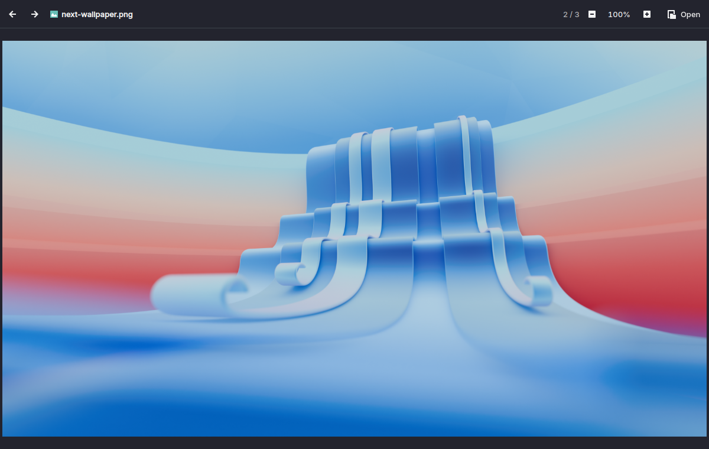
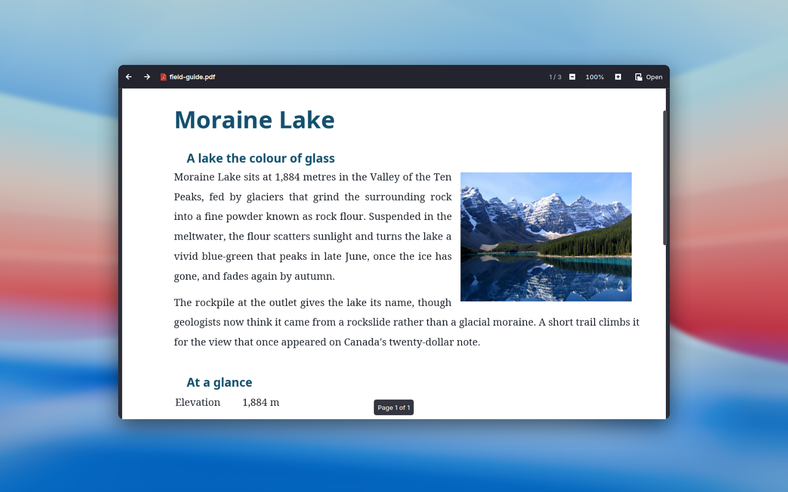
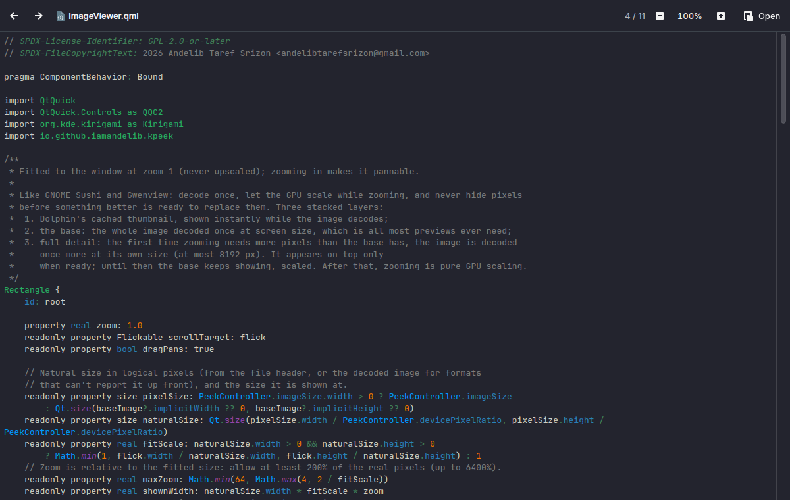

<p align="center">
  
</p>

# KPeek

**Quick Look for Dolphin.** Tap <kbd>Meta</kbd>+<kbd>Space</kbd> on a file and it pops up. Tap again and it's gone.



<p align="center">
  
  
</p>

## Highlights

- **Quick, then gone.** Pops up in a fraction of a second, showing Dolphin's own thumbnail while the full
  file loads. Close it and nothing keeps running: no background process, no tray icon.
- **Previews nearly everything.** Photos (HEIC, AVIF, JPEG XL, animated GIF/WebP), PDFs and comic books,
  video and music, code in 300+ languages, Markdown, 3D models, archives and fonts.
- **Glide through folders.** <kbd>←</kbd> <kbd>→</kbd> walk the whole folder or just your selection.
  <kbd>Ctrl</kbd>+wheel zooms anything; drag to pan.
- **Featherweight.** Photos decode once at screen size (a 24 MP shot peaks around 225 MB), the graphics card
  does the zooming and the video decoding, and closing
  it frees everything.
- **Sandboxed and private.** A Flatpak that opens your files read-only and never touches the network.
- **Any desktop.** Plasma, GNOME, Xfce or a tiling window manager: if you use Dolphin, KPeek works.

Like [PowerToys Peek](https://learn.microsoft.com/windows/powertoys/peek) for Windows Explorer and
[Sushi](https://gitlab.gnome.org/GNOME/sushi) for GNOME Files, built for Dolphin.

## What it previews

| | |
|---|---|
| **Images** | JPEG, PNG, WebP, AVIF, JPEG XL, HEIC, SVG, animated GIF and WebP |
| **Documents** | PDF, comic books (CBZ, CBR, CB7, CBT), office files (their built-in first-page preview) |
| **Media** | Video and audio, with seeking and track info |
| **Text** | Source code with syntax highlighting, rendered Markdown |
| **3D** | glTF/GLB, OBJ, STL, 3MF; drag to orbit |
| **Archives** | zip, tar, 7z, RAR, ISO, deb, rpm and more, as a browsable tree |
| **Fonts** | A specimen at several sizes |
| **Everything else** | Dolphin's thumbnail plus type, size and date |

## Install

KPeek runs as a Flatpak, so it works on any distribution with Flatpak, and with Dolphin on any desktop:
Plasma, GNOME, Xfce or a tiling window manager.

**From Dolphin (recommended).** Open *Settings → Configure Dolphin… → Context Menu → Download New Services…*,
search for **KPeek** and click *Install*. A terminal window shows the progress: it downloads KPeek, and the
first time also the KDE runtime it runs on (a 400 MB download, shared with other KDE Flatpaks). Restart Dolphin
afterwards. When a new version is out, the same dialog offers *Update*. The installer checks the download against
the release's checksum.

**By hand.** Download `kpeek-servicemenu-<version>.tar.gz` from the
[latest release](https://github.com/IamAndelib/KPeek/releases/latest), then:

```sh
tar -xzf kpeek-servicemenu-*.tar.gz
kpeek-servicemenu/install-it.sh   # installs the newest KPeek Flatpak and adds "Peek" to Dolphin
```

**The shortcut** (Dolphin 26.04 or later): the installer binds *Peek* to <kbd>Meta</kbd>+<kbd>Space</kbd>, unless
another Dolphin action already uses that key or you had already given Peek a shortcut. To change it, open
*Settings → Configure Keyboard Shortcuts* in Dolphin and search for *Peek*. On GNOME, <kbd>Super</kbd>+<kbd>Space</kbd>
switches the keyboard layout before Dolphin sees it: pick another key there. Without a shortcut, right-click a file
and choose *Peek*.

**Uninstall** from the same *Download New Services* dialog, or run `kpeek-servicemenu/uninstall.sh`. Either also
removes the shortcut and forgets whether you hid *Peek* in Dolphin's context menu settings, so a reinstall starts shown.

## Keys and mouse

With several files selected, KPeek moves through those; with one, through its whole folder. It works in the
Trash too.

| Input | Action |
|---|---|
| <kbd>←</kbd> <kbd>→</kbd> | Previous / next file |
| Mouse wheel, <kbd>↑</kbd> <kbd>↓</kbd> <kbd>PgUp</kbd> <kbd>PgDn</kbd> <kbd>Home</kbd> <kbd>End</kbd> | Scroll |
| <kbd>Ctrl</kbd>+<kbd>+</kbd> <kbd>Ctrl</kbd>+<kbd>−</kbd> <kbd>Ctrl</kbd>+<kbd>0</kbd>, <kbd>Ctrl</kbd>+wheel | Zoom in, out, reset (everything but media and archives). The header shows the zoom level, with zoom buttons and a reset button. |
| <kbd>Ctrl</kbd>+drag | Grab and move the content; zoomed images and document pages also pan with a plain drag |
| <kbd>Enter</kbd> | Open in the default application |
| <kbd>Meta</kbd>+<kbd>Space</kbd>, <kbd>Space</kbd>, <kbd>Esc</kbd>, <kbd>Q</kbd> | Close |
| <kbd>K</kbd>, <kbd>J</kbd> / <kbd>L</kbd>, <kbd>M</kbd> | Play/pause, back/forward 10 seconds, mute (media) |
| <kbd>Ctrl</kbd>+<kbd>U</kbd> | Show the Markdown source |

## Troubleshooting

- Video plays badly or not at all with a broken GPU driver: start with `QT_FFMPEG_DECODING_HW_DEVICE_TYPES=,`
  to decode on the processor.
- Rendering problems with an unusual GPU: try `QSG_RHI_BACKEND=vulkan`, or `QT_QUICK_BACKEND=software`.
- Force the low-memory limits: `KPEEK_LOW_MEMORY=1`.

## How it integrates with Dolphin

Dolphin has no plugin API for reading the current selection. KPeek therefore ships as a **service menu**: a "Peek" entry in
Dolphin's context menu that receives the selected files. Dolphin 26.04 and later let you put a keyboard shortcut on a service menu
action, so you can bind it under *Settings → Configure Keyboard Shortcuts → Peek*. The suggested shortcut is <kbd>Meta</kbd>+<kbd>Space</kbd>;
plain Space already toggles Dolphin's selection mode.

KPeek shows one preview window at a time: the shortcut on another file switches it, and on the file being shown
closes it. Closing the preview quits KPeek, so nothing stays in the background.

## Requirements

- Dolphin, on any desktop; Dolphin ≥ 26.04 for the keyboard shortcut (the context menu entry works with older versions)
- Flatpak
- To build from source: Qt ≥ 6.8, KDE Frameworks ≥ 6.10, Kirigami, Poppler (Qt 6), libarchive, libdbus, QtMultimedia,
  Qt Quick 3D, KSyntaxHighlighting. Optional: LibreOffice, for rendering every page of office documents

## Building

```sh
cmake -B build -G Ninja
cmake --build build
ctest --test-dir build
./build/bin/kpeek some-file.pdf
```

### Development setup

Development happens in a Fedora [distrobox](https://distrobox.it/) so the host system stays clean. To try a build from
your real Dolphin:

```sh
scripts/dev-install-servicemenu.sh          # adds "Peek" to Dolphin, running ./build/bin/kpeek
scripts/dev-install-servicemenu.sh --remove # undo
```

Then bind the shortcut as described above and restart Dolphin.

To build the Flatpak bundle and the KDE Store package (needs `flatpak-builder` and the KDE 6.11 SDK):

```sh
scripts/build-flatpak.sh        # writes kpeek.flatpak and installs it for your user
scripts/build-store-package.sh  # writes dist/kpeek-servicemenu-<version>.tar.gz
```

Pushing a `v*` tag builds both and attaches them to a GitHub release. After rebuilding, close any open preview
(or run `pkill -x kpeek`): an open preview keeps running the old binary. Set `QT_FORCE_STDERR_LOGGING=1` to see Qt's
messages in the terminal instead of the system journal.

## Contributing

Bug reports and pull requests are welcome on [GitHub](https://github.com/IamAndelib/KPeek).

- **Style:** KDE's [coding style](https://community.kde.org/Policies/Frameworks_Coding_Style), enforced by clang-format.
  Run `cmake --build build --target clang-format` before committing; the pre-commit hook that CMake installs checks it.
- **Tests:** add or update a test in `autotests/` for logic changes (C++ with QtTest, UI behaviour as
  `autotests/qml/tst_*.qml`), and keep `ctest --test-dir build` green.
- **Layout:** `src/` holds the C++ backend, with `src/qml/viewers/` holding one QML file per preview type. A new
  preview type is a `XxxViewer.qml` plus a MIME rule in `src/viewerresolver.cpp`. Viewers take part in
  zoom, drag and keyboard scrolling by exposing `zoom`, `scrollTarget` and optionally `dragPans` and `maxZoom` (see `src/qml/ViewerInput.qml`).
- **Licensing:** the project follows [REUSE](https://reuse.software/): new files need SPDX headers (`reuse lint` checks).
- **CI:** every push builds and tests on Fedora; `.github/workflows/ci.yml` lists the exact dependencies.

Please follow the [KDE Community Code of Conduct](https://kde.org/code-of-conduct/).

## Roadmap

- [x] Image, PDF, office, media, text/code, Markdown, archive, comic, 3D model and font viewers
- [x] Universal zoom and grab-to-pan
- [x] Flatpak, and one-click install from Dolphin's *Download New Services* (KDE Store)
- [ ] Flathub
- [ ] Polish: window resizes to fit images, pin the window size, settings

## How KPeek was made

KPeek's maintainer directed its design and tested it on real hardware, and wrote it together with an AI
coding assistant (Anthropic's Claude): most of the code, tests, packaging scripts and documentation were
drafted with its help and reviewed, tested and revised before being committed. Commits it contributed to
carry a `Co-Authored-By: Claude` line.

## License

GPL-2.0-or-later. Build files are BSD-2-Clause. See [`LICENSES/`](LICENSES/).

The screenshots show KDE Plasma's "Next" wallpaper (CC-BY-SA-4.0, by the KDE Visual Design Group) and a
[photo of Moraine Lake](https://commons.wikimedia.org/wiki/File:Moraine_Lake_17092005.jpg) by Gorgo (public domain).
